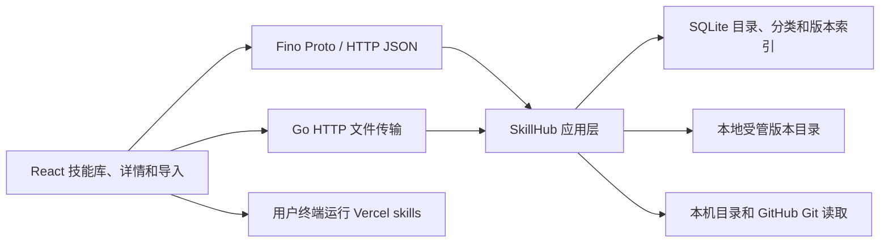

# SkillHub 技能库架构方案

SkillHub 以当前本机单用户工作台为部署起点，沿用 React、Fino Go 服务、SQLite 和本地文件存储。首页是日常管理入口，主要操作为搜索、整理、上传和下载。

## 1. 现状与目标

| 能力 | 当前工作区 | 目标 |
| --- | --- | --- |
| 自有 Skill | 扫描本机目录，收录时保存版本副本 | 保留目录扫描，增加浏览器上传 ZIP 和为已有条目上传新版本 |
| 网上公开 Skill | 支持 GitHub 仓库和子目录，记录固定 commit | 预览并勾选收录，保存该 commit 对应的受管副本，后续可离线查看、比对和下载 |
| 整理 | 已有分类、标签、备注，首页搜索覆盖已加载条目 | 全库搜索、组合筛选、批量改分类和增删标签 |
| 分发 | 可生成 Codex 安装命令，当前服务契约未提供下载 | 列表一键下载当前版本，详情可下载指定历史版本，多选可导出集合 ZIP |
| 版本 | 本地按内容保存，GitHub 按 commit 保存；已有差异界面 | 三种来源统一使用版本历史和比对；GitHub 检查更新后由用户选定并收录 |

首版的外部导入源为 GitHub。其他网站公开的 Skill 可以用下载所得的 ZIP 收录。条目默认只在本机库中可用，来源是否公开由上游决定。自有和外部 Skill 都能按用途归类，来源与分类作为独立筛选条件。

## 2. 成熟方案与复用决策

| 方案 | 已提供的能力 | SkillHub 的用法 |
| --- | --- | --- |
| Agent Skills 规范 | 以目录为发布单元，包含带 YAML frontmatter 的 `SKILL.md` 和可选配套文件 | **采用格式**。归档保留目录、原文和配套文件。复用现有 Go YAML 解析和目录扫描，按规范补齐必要的字段校验。以官方示例做兼容验证。 [规范](https://agentskills.io/specification) |
| Vercel `skills` | npm CLI 可从 Git 仓库或本地路径安装 Skill，支持选择目标 Agent | **直接复用安装**。继续生成固定 CLI 版本的 Codex 安装命令。用户在目标项目终端运行；下载 ZIP 解压后也可安装。 [CLI 文档](https://github.com/vercel-labs/skills/blob/main/docs/commands.md) · [npm 发布元数据](https://registry.npmjs.org/skills/latest) |
| ClawHub | 有浏览、`SKILL.md` 渲染、版本发布和搜索，运行在 Convex 等服务上 | **参考交互**。将说明、文件、历史版本集中在同一个详情入口，沿用现有本地服务实现个人整理和分发。 [ClawHub 项目](https://github.com/openclaw/clawhub#what-you-can-do-with-it) |
| Git / GitHub | 支持按固定 commit 读取仓库内容和源代码归档 | **直接复用现有 Git checkout**，继承现行 HTTPS 凭据行为。预览锁定 commit，保存该 commit 下选中的 Skill 目录。若以后需要无 Git 部署，再评估 GitHub Archives API。 [GitHub 归档语义](https://docs.github.com/en/repositories/working-with-files/using-files/downloading-source-code-archives) |
| Go 标准库、React 组件 | `archive/zip` 提供 ZIP 编解码，`react-dropzone` 提供文件拖放，`react-markdown` 已是仓库依赖 | **直接复用** ZIP 读写、拖放与 Markdown 展示，保留现有差异组件。应用层实现归档限制、版本规则和错误反馈。 [Go ZIP](https://pkg.go.dev/archive/zip) · [react-dropzone](https://github.com/react-dropzone/react-dropzone) · [react-markdown](https://github.com/remarkjs/react-markdown) |

官方 `skills-ref` 用作规范验证的对照工具。其维护者说明该库供演示使用，服务继续使用现有 Go 解析器。 [skills-ref](https://github.com/agentskills/agentskills/tree/main/skills-ref)

## 3. 页面与交互

| 位置 | 内容与操作 |
| --- | --- |
| 技能库 `/` | 主按钮「添加 Skill」。搜索名称、说明、分类、标签；按来源、分类、标签组合筛选。默认按最近更新排列。列表列出名称、用途、分类、标签、来源和当前版本状态。行内「下载」直接取当前版本。 |
| 添加 Skill 弹窗 | 三个入口「上传 ZIP」「导入 GitHub」「扫描本机目录」。预览显示候选 Skill、来源和校验问题，支持勾选、选择分类和添加标签。批量结果逐条显示新增、已收录或失败原因。 |
| Skill 详情 `/skills/:skillId` | 展示版本对应的 `SKILL.md`、文件清单、来源链接和许可信息（如有），可编辑分类、标签和备注。版本区支持下载、比对、复制安装命令，并按来源显示「上传新版本」「检查更新」或「保存新版本」。 |
| 分类与多选 | 列表上方提供分类筛选，包含「全部」和「未分类」。从分类入口可批量重命名或合并现有分类。多选操作支持改分类、添加或移除标签、下载选中条目的当前版本。 |

一条 Skill 有一个可空主分类和多个标签。例如分类为「开发」，标签为「Go」「CI」。分类由已使用的名称组成，新分类可在收录和整理时输入。关键词与不同维度的筛选取交集，同一查询中的多个标签也取交集。筛选状态写入 URL；服务端在分页前完成搜索与筛选。多选下载提交明确的 Skill ID，服务在请求开始时解析并固定每个 ID 对应的版本。

## 4. 组件边界

- **前端**复用现有列表、录入弹窗、版本面板、主题和比对组件。元数据走 Fino 生成客户端，文件上传使用 `FormData`，下载使用服务返回的 ZIP。预览从指定已保存版本读取；切换版本时说明和文件清单一起更新。
- **应用与领域**继续使用 `app` 编排、`domain/service` 管理扫描和文件规则、`domain/repo` 定义持久化调用。三种来源共用版本写入流程，GitHub 读取和 ZIP 解包只负责提供受控的输入目录。
- **持久化**复用 SQLite 目录事务和现有快照目录布局 `<skill-id>/<version-id>/<version-name>/`。版本目录保存普通文件、目录和脚本的属主执行位。详情、比对、打包和安装共享同一个版本解析入口。
- **传输**元数据接口以 `proto/skillhub/` 为责任源。文件接口使用同源 Go HTTP handler，沿用相同的校验和错误约定。当前 `api/run.go` 标有生成归属。实施时在现有用户维护的装配入口接入 HTTP handler，若当前模板缺少挂载点，先在 Fino 模板提供扩展入口并重新生成。

## 5. 数据模型与唯一性

| 模型 | 字段与语义 |
| --- | --- |
| `Skill` | 复用 ID、名称、说明、分类、备注和时间戳。增加 `source_kind` 和唯一 `source_key`，复用 GitHub 仓库、子目录和本机路径字段。名称和说明来自当前版本，分类、标签、个人备注由用户维护。 |
| `SkillTag` | 复用 `(skill_id, tag)` 唯一约束。分类和标签去除两端空白，分类合并和标签增删在 SQLite 事务中提交。 |
| `SkillVersion` | 复用版本 ID、归属、版本名、备注、`source_ref`、`commit_sha`、`content_digest`。增加快照状态、版本描述、可选许可字段和新版内容摘要。快照位置按既有 ID 路径推导。 |

- GitHub 条目按规范化的仓库和子目录识别，目录来源按解析后的真实路径识别。ZIP 新条目用独立 ID 生成来源键；同名时提示用户「保存到已有 Skill」或「创建独立条目」。同名可以共存。
- GitHub 版本按 `(skill_id, commit_sha)` 幂等。若候选 commit 的 Skill 内容和当前版本相同，页面显示内容无变化，可继续使用当前版本。若后来上游回退到某个更早版本的内容，和当前版本不同时仍可收录新的 commit。ZIP 和目录版本按同一条目的内容摘要复用已有记录。重复上传返回已有版本；若希望复用的历史内容成为当前版本，首版可在该历史版本直接下载，当前版本由最后成功收录的版本确定。
- 首版以 `create_time DESC, id DESC` 定义当前版本，列表从同一版本查询派生当前版本 ID。使用确定性排序；分页 token 绑定查询条件。SQLite 查询用参数绑定和 `EXISTS` 完成标签过滤，小型个人库用子串查询覆盖中文和英文。后续根据实际规模再考虑全文索引。
- 新版摘要使用 SHA-256，按排序后的规范相对路径、文件字节摘要和受支持的属主执行位计算。旧本地摘要只覆盖路径和文件字节。保留旧摘要供已有接口和预期摘要检查使用，回填新版摘要后再用于跨来源比较。ZIP 的压缩时间和压缩级别不参与内容判定。
- 迁移将旧位置复合唯一索引替换为 `source_key` 的唯一约束，允许多个 ZIP 条目同时存在。版本的 GitHub commit 唯一性与本地内容唯一性分别建立约束，避免 GitHub 旧版本补写摘要后改变 commit 的去重语义。

## 6. 上传、收录和下载

### ZIP 上传

1. 拖入或选择 ZIP。服务端将上传流写入有上限的临时文件，在受控目录里扫描。支持一份 Skill 目录、根部直接包含 `SKILL.md` 的单包，以及包含多个 Skill 目录的集合 ZIP。
2. 预览接口返回短期 `uploadId` 和候选 ID。目录名与规范名不一致时，显示问题；只有 ZIP 根部直接包含 `SKILL.md` 的单包以其 `name` 创建外层目录。每个候选保留其配套文件。
3. 用户勾选条目并确认整理信息。新增或为指定条目保存版本由应用层处理。上传会话为每个候选预分配新条目 ID，确认请求重试沿用该 ID，避免响应丢失时重复创建。保存新版本时校验目标条目和 `SKILL.md` 的名称；失败时保留本次会话的预览供重试。取消或到期后清理暂存内容。

### GitHub 导入和本机扫描

1. GitHub 入口接受仓库、分支或标签，以及可选的仓库内路径。复用现有单个 Skill 和 `skills/` 批量预览。确认时按预览返回的完整 commit 读取选中的目录。
2. GitHub 更新沿用「检查更新 → 查看差异 → 保存版本」。本机来源沿用「扫描目录 → 收录」和后续的摘要校验。三个入口统一落入受管版本目录。
3. 写入前以实际暂存副本校验元数据和摘要。GitHub 导入保留仓库、路径、ref 和完整 commit，复制 Skill 目录内已有的许可证文件；详情另显示可获得的仓库许可信息。库内是否收录和来源许可信息分别展示。

### 保存和并发

在快照根目录下暂存并校验完整内容，随后原子重命名发布版本目录，再用 SQLite 事务写入索引并更新当前条目元数据。目录发布失败时不写索引；事务失败时清理本次发布的目录。崩溃可能留下未引用目录，启动时按数据库引用做完整性检查。批量导入以每条为提交单位，结果携带条目和版本 ID，可只重试失败项。同一条目的并发收录由数据库唯一约束决定胜者，重复请求读取已存在记录。

### 下载和安装

- 单个 Skill 下载返回 `<version-name>.zip`，ZIP 内只有一层 `<version-name>/` 根目录。版本 ID 与所属条目一并校验。文件名取所下载版本的名称，保持历史包可直接解压和安装。
- 多选下载打成集合 ZIP。遇到同名 Skill，用外层目录区分，内部 Skill 目录保持规范名称，例如 `library/<skill-id>/<version-name>/SKILL.md`。上传扫描识别此导出结构，可将集合导回库中。
- 先校验全部版本可读、大小上限及归档路径，再把 ZIP 写到有界临时文件，成功后以 `application/zip` 和附件响应发送，结束或取消时清理。受管版本打包无需访问 GitHub。原版无副本的 GitHub 条目显示补齐状态，迁移成功后才能离线下载。
- 本机部署继续生成基于快照目录的项目级或全局安装命令。用户拿到 ZIP 时可先解压，在目标终端用固定版本的 `skills add` 安装到 Codex。

## 7. 接口面与运行约束

所有 API 使用现有 `/skillhub/v1` 前缀。下表为目标接口，保留旧接口的参数和语义，新增字段走兼容演进。

| 类别 | 接口 | 约定 |
| --- | --- | --- |
| 查找 | `ListSkills`、`GetSkill` | 列表增量支持 `keyword`、`sourceKind`、`tags`；携带当前版本摘要和下载状态 |
| 整理 | `UpdateSkill`、新增 `BatchUpdateSkillMetadata`、`ListCategories`、`RenameCategory` | 单条维持现有替换接口；批量按显式 ID 更新分类或增删标签，整次事务提交 |
| 导入与历史 | `ScanProject`、`PreviewImport`、`ImportSkill`、`CreateVersion`、`ListVersions`、新增 `GetVersionContent` | 复用现有目录和 GitHub 流程；内容查询返回指定版本的说明和文件清单 |
| ZIP 预览与确认 | `POST /skillhub/v1/uploads`、新增 Fino RPC `CommitUpload` | 前者接收 multipart 文件，返回会话及候选；后者接收 `uploadId`、候选及整理信息，或指定已有条目作为版本目标 |
| 下载 | `GET /skillhub/v1/skills/{skillId}/versions/{versionId}/archive`、`POST /skillhub/v1/archives:download` | 前者直接用于列表下载和指定版本下载；后者接收显式 Skill ID 列表并返回集合 ZIP |
| 比对与安装 | `CompareSkills`、`GetInstallCommand` | 继续用现有接口；已持久化版本统一从快照目录解析 |

服务继续监听回环地址。浏览器走同源请求，写入接口校验来源；本机目录扫描仅在本机部署启用。导入使用 GitHub HTTPS 地址，私有源沿用本机配置的 Git 凭据。预览按纯文本读取脚本，Markdown 使用安全渲染，限制外链图片和原始 HTML。

单 Skill 沿用现有 20 MiB 单文件、64 MiB 解包总量、10,000 文件上限。集合包另设压缩体积、总解包体积、条目数和并发暂存配额，数值在实施时和代表性包一起验证。限额依据实际已读字节，拒绝绝对路径、目录穿越、规范化后重名、符号链接、特殊文件及嵌套 Skill 根目录。ZIP 解包和打包都在限定目录内完成，服务不加载或运行技能脚本。

SQLite 和快照目录作为同一份备份。延续停服备份两者的约定，恢复后校验版本文件是否可读。目录迁移先备份再演进，旧本地副本原位保留；GitHub 历史记录在现有 commit 上逐条补齐材料，远端失效时保留可重试的记录和明确错误状态。

## 8. 实施顺序与验收

| 阶段 | 交付和验收 |
| --- | --- |
| 1. ZIP 上传与单版下载 | 先迁移来源键和版本约束，复用快照规则上线上传、预览、确认和下载。一个有脚本及资源的 Skill 可完成上传 → 下载 → 解压 → 再上传，验证字节、目录结构和支持的执行位。重复上传、非法 ZIP、超限和跨条目版本 ID 有明确结果。 |
| 2. GitHub 受管版本 | 固定同一次预览的 commit，复用一次 checkout 收录多个条目；迁移既有 GitHub 版本。分支更新后旧版本内容保持固定。断网可下载或比对已补齐的历史版本，远端无法访问的遗留版本显示状态。 |
| 3. 技能库整理与集合下载 | 完成全库筛选、标签和分类批量整理及版本详情。验证分页后才出现的条目能被检索，分类重命名保留标签，集合导出可重新导入，同名 Skill 均可解压。 |

实现阶段先修改 Proto 和应用扩展点，生成并检查受影响的 Go、服务和前端产物，保留 `DO NOT EDIT` 文件的生成归属。用 `go -C go test ./...`、`go -C backend test ./...` 和 `npm --prefix frontend run build` 验证，再实际启动服务，通过浏览器走通上传、整理、下载和 GitHub 更新流程。
