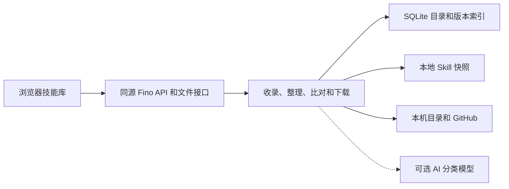

# SkillHub 技能库架构方案

SkillHub 是本机单用户的 Skill 资料库。自有 Skill 和第三方 Skill 收录后都有本地版本副本，可以按用途和来源查找、比对和下载。首页以搜索、导入文件夹和保存到本机为主，文件、版本和长说明放到详情。

页面布局和交互见 [SkillHub 前端页面设计](SKILLHUB_FRONTEND_DESIGN.md)。

## 1. 使用流程

| 场景 | 用户操作 | 结果 |
| --- | --- | --- |
| 首次启动 | 运行发布包，打开启动时显示的本地地址 | 自动创建数据目录并进入技能库。GitHub 和 AI 的依赖在第一次使用对应功能时提示。 |
| 导入自有 Skill | 点「导入文件夹」，在系统窗口选中 Skill 文件夹 | 单个有效 Skill 选中后直接入库，分类和标签可稍后补。遇到同名条目时提示选择。从详情也可选择文件夹保存为指定条目的历史版本。 |
| 收录 GitHub Skill | 粘贴仓库或目录链接，按需选择分支、标签或 commit，预览并收录 | 预览解析到完整 commit。确认后保存对应目录的完整 Skill 副本，后续可离线下载、查看和比对。单条直接确认，仓库含多个候选时提供勾选。 |
| 批量收录本机 Skill | 选中项目或集合文件夹，勾选扫描到的 Skill | 保留原目录作为更新入口。原目录移动后，已保存版本仍可用。 |
| 查找和整理 | 搜索名称或用途，按分类、标签和来源筛选 | 结果来自全库。用途可编辑，一条 Skill 有一个可空主分类和多个标签。多选时提供批量整理。 |
| 更新和比对 | 在详情选择文件夹、读取原目录或检查 GitHub 更新，预览差异后保存 | 版本保存后可与任意已保存版本比对。版本区可指定默认下载版本。 |
| 保存到本机 | 在列表或版本历史点击「保存到本机」。需要换位置时使用「另存到…」 | 列表取默认版本，历史入口取指定版本。直接生成可用的 Skill 文件夹，完成后显示保存位置。分享时可从详情选择「下载 ZIP」。 |

首页每行显示名称、一行用途、来源、分类标签和默认版本。详情显示 `SKILL.md`、文件、来源链接和版本历史。导入入口优先显示「导入文件夹」和「导入 GitHub」。新条目的短用途可留空，此时列表预览默认版本的 `description`。用户填写的短用途与原始描述分别保存，切换或更新默认版本时保留用户填写的内容。

「线上版本上传下载」的首版范围是 GitHub 版本收录到本机并可下载。是否需要从 SkillHub 发布到有写权限的 GitHub 仓库，按实际发布频率单独确定。

## 2. 来源、版本与管理规则

### 来源和导入方式

- 上游出处记录可选名称和链接，例如 Fino、OpenAI 或 Vercel。GitHub 直连可用仓库所有者和链接作为默认出处，本机目录和 ZIP 可根据项目 `README` 或 Skill 的 `NOTICE.txt` 手动补录。列表优先显示记录的出处，详情显示出处、导入方式和实际更新绑定。补录出处只影响展示和筛选，更新操作使用独立绑定的仓库或本机目录。
- GitHub 直连条目按规范化的仓库和子目录去重，本机目录按解析后的真实路径去重。例如本项目的 `.agents/skills` 指向 `skills/`，两种入口扫描到同一 Skill 时只收录一次。目录入口允许解析项目内的别名，快照仍按现有规则检查 Skill 内容。ZIP 同名时提示「保存到已有 Skill」或「新建独立条目」。
- 从 SkillHub 导出的带来源 ZIP 可包含顶层 `.skillhub.json`，记录该版本的上游仓库、目录和完整 commit 等可移植来源信息。元数据与 Skill 目录并列，导入时独立校验。ZIP 声明的来源可在详情追溯，内容以实际归档为准。它不会自动绑定 GitHub 更新、覆盖已收录的同来源条目，或改写条目的可信来源。导出包省略本机绝对路径、备注和凭据。
- 普通 ZIP 无来源信息时显示「ZIP」。文件夹导出保留原有 Skill 目录，重新收录时按本机目录来源处理。需要将原 GitHub 来源一并传给另一份库时，使用带来源的 ZIP。GitHub 收录保留 Skill 目录内的许可文件，并展示可获取的许可信息。

### 历史版本和默认下载

- GitHub 版本显示短 commit SHA，本机和 ZIP 版本显示短内容摘要，均附保存日期。默认展示前 8 位，冲突时延长，可复制完整值。内部按完整版本 ID 操作。
- 第一次收录时将首个版本设为默认。后续保存提供「同时设为默认」，补录历史版本时保持原默认，也可在历史列表显式切换。最近收录按保存时间排序，默认下载以条目上的默认版本 ID 为准。默认快照缺失时显示「待补齐」，可重试收录或改选已有副本。
- GitHub 按条目和完整 commit 去重。本机和 ZIP 按条目和内容摘要去重。GitHub 候选 commit 的 Skill 内容相同仍可按需收录，预览提示内容无变化。重复导入已有版本时返回该版本，可直接设为默认。
- 比对默认选择「默认版本 → 待收录版本」，也可在历史中任选两个已保存版本。复用现有文件差异，文本展示逐行变更，二进制文件仅展示变更状态。

### 删除、备份和恢复

- 删除历史版本时，默认版本需先改为其他可下载版本。删除整个条目需确认，并移除关联索引和受管副本。本机原目录或 GitHub 仓库只作为读取来源。
- 删除先在 SQLite 事务中移除索引，再清理失去引用的受管文件。清理失败留待重试，进行中的导出、下载和比对持有对应版本，结束后才清理。启动时检查快照引用并清理可确认的遗留暂存。
- 停止服务后备份整个数据目录，恢复时使用完整的数据库和快照，保留用途、分类、来源、版本历史和默认版本。导出的文件夹和 ZIP 用于文件流转。部署验收包含恢复一份备份后离线比对和下载历史版本。

## 3. 单机部署与实现边界

构建时将 React 静态产物嵌入 Go 发布包。同一回环地址提供页面和 API，SQLite 和快照存放于可配置的数据目录。源代码开发沿用 Fino 和 Vite。GitHub 读取复用本机 Git 和现有 HTTPS 凭据；本地文件夹导入、导出、搜索和比对由 SkillHub 进程完成。图形桌面使用系统目录选择器，无图形桌面时可输入本机路径。 [Go embed](https://pkg.go.dev/embed)

| 组件 | 职责 |
| --- | --- |
| React | 复用现有列表、主题、详情、比对和安装命令组件。元数据和本机文件夹操作走生成客户端，ZIP 走文件上传和附件响应。搜索和筛选写入 URL。 |
| Fino 和 Go | 元数据契约以 `proto/skillhub/` 为责任源。三种输入经应用层进入同一版本保存流程。ZIP 由同源 Go HTTP handler 处理。经用户维护的装配入口挂载；模板缺少扩展点时先更新模板并重新生成。 |
| SQLite 和快照 | 复用目录与版本事务及 `<skill-id>/<version-id>/<version-name>/` 快照布局。所有已收录来源使用同一读取入口供详情、比对、打包和安装。 |
| 成熟工具 | 采用 Agent Skills 目录格式。复用现有 Go YAML 解析、`archive/zip`、现有 Markdown 与差异组件，目录选择复用 Go 的 `zenity.SelectFile` 和目录模式，Codex 安装沿用 Vercel `skills`。详情与版本交互参考 ClawHub。 [Agent Skills 规范](https://agentskills.io/specification) · [Go ZIP](https://pkg.go.dev/archive/zip) · [Go 原生目录选择](https://pkg.go.dev/github.com/ncruces/zenity#SelectFile) · [Vercel skills](https://github.com/vercel-labs/skills/blob/main/docs/commands.md) · [ClawHub](https://github.com/openclaw/clawhub#what-you-can-do-with-it) |

### 数据和迁移

| 模型 | 变更 |
| --- | --- |
| `Skill` | 保留 ID、名称、说明、分类、备注和时间戳。增加来源类型、导入方式、唯一来源键、可选上游名称与链接、可空短用途及默认版本 ID。原始描述从默认版本读取，短用途独立保存。 |
| `SkillTag` | 保留 `(skill_id, tag)` 唯一约束。批量更新在数据库事务提交，分类和标签名称经去空白处理。 |
| `SkillVersion` | 保留版本 ID、名称、备注、来源 ref、完整 commit 和内容摘要。增加版本描述、快照状态、新版摘要，以及按版本保存的可移植来源信息。 |
| AI 整理任务 | 启用 AI 阶段后保存任务状态、逐条建议、失败原因和候选条目的元数据修订值。 |

新版内容摘要使用路径、文件字节和支持的属主执行位。旧摘要保留兼容，新摘要回填后用于新版去重。迁移用来源键替换旧位置复合唯一约束，分别约束 GitHub commit 和本机内容，保持既有条目、版本 ID 和快照路径。已有条目以迁移前的当前版本初始化默认版本；尚无快照的 GitHub 版本按原 commit 补齐，远端失效时保留条目和可重试状态。换默认版本时与条目元数据一并更新。

### 文件夹导入和导出

- 本机浏览器发起目录选择，由 Go 进程在同一桌面会话打开系统窗口。选定的真实路径交给现有扫描和快照逻辑，直接保留文件、子目录和支持的执行位。取消选择即返回列表；系统对话框不可用时提供路径输入。目录选择和本机文件写入限定在回环服务的同源请求。
- 「保存到本机」默认写入系统下载目录下的 `SkillHub`，找不到可写的下载目录时用数据目录下的 `exports`。用户可改默认位置，也可通过「另存到…」为当前版本选位置。只写入新建的 Skill 目录，已有同名目录时用版本标识区分外层目录，保持内部 Skill 目录名与规范名一致。
- 使用同一版本快照复制完整目录，复制到目标位置的临时目录，完成后再发布并返回路径。失败或取消时清理临时文件。常用操作只需要一次点击；文件夹可直接使用或通过 Vercel `skills` 安装。

### 共用导入规则与 ZIP 交换

- 文件夹和 ZIP 支持单个 Skill 或集合。单文件上限为 20 MiB，每个 Skill 最多 64 MiB、10,000 个文件。ZIP 另限制压缩体积、总解包量、候选数量和同时暂存量。拒绝目录穿越、重名路径、符号链接、特殊文件和嵌套 Skill 根。渲染 Markdown 时限制原始 HTML 和远程图片，脚本以文本查看。
- 确认收录时复用预览锁定的 commit、目录内容摘要或 ZIP 会话。相同 ZIP 会话、候选重试沿用同一个条目 ID。写入时先在快照根目录下暂存和校验，再原子重命名版本目录，最后提交数据库索引和默认版本变更。事务失败清理本次快照。批量按单条提交并返回新增、重复或失败，可只重试失败项。
- 单版下载用 `<version-name>.zip`，主体为同名 Skill 目录，可附来源元数据。先在有界临时文件完成归档，再发送附件，完成或取消后清理。已收录的 GitHub 版本从本机快照打包。
- 搜索与筛选在 SQLite 分页前完成，分页使用稳定排序。查询覆盖名称、短用途、默认版本的原始描述、分类和标签，可按展示来源和未分类状态筛选。
- 版本文件预览按 Skill ID、版本 ID 和规范相对路径读取快照。Markdown 的相对文件链接以当前文档所在目录解析，只读取该版本根目录内的普通文件。文件缺失或无法预览时提示原因，保留返回正文的入口。文本预览按大小限制读取，脚本仅作为文本展示。

## 4. AI 批量整理

1. 在「未分类」结果或手动多选后启动。默认补齐空用途和空分类；标签为空时给出一组建议。已有整理字段可由用户主动纳入本轮。
2. 后端按批提供条目 ID、名称、版本说明和现有分类标签，要求返回结构化建议。优先匹配已有分类和标签，新名称单独标记，依据不足可留空。首个适配器建议复用本机 Ollama，后端校验条目和字段。 [Ollama structured outputs](https://docs.ollama.com/capabilities/structured-outputs)
3. 页面显示现有值和建议，可编辑、勾选并一次应用。批次由 Go 进程处理，状态和结果存 SQLite。失败项可重试。应用前核对条目修订值，避免覆盖生成期间的人工编辑；只修改用途、分类和标签。
4. 用现有 Skill 建一组带人工分类的样例。验收记录直接采纳、修改和留空的数量，检查近义分类、已有分类复用和信息不足的条目。关闭模型后仍可照常手动整理。

## 5. 接口范围

以现有 `/skillhub/v1` 为前缀。已有 RPC 保持调用方式，新增字段和操作按 Proto 兼容演进。

| 用途 | 接口 |
| --- | --- |
| 查找和整理 | 扩展 `ListSkills`、`GetSkill`、`UpdateSkill`，增加 `BatchUpdateSkillMetadata`、`ListCategories`。 |
| 收录和历史 | 复用 `ScanProject`、`PreviewImport`、`ImportSkill`、`CreateVersion`、`ListVersions`。增加 `GetVersionContent`、`GetVersionFile`、`SetDefaultVersion`、`DeleteVersion`，沿用 `DeleteSkill`。 |
| 本机文件夹 | 增加 `SelectLocalDirectory` 启动系统目录选择，复用 `ScanProject` 和 `ImportSkill` 收录。增加 `ExportVersionToDirectory` 保存固定版本，列表使用默认版本 ID。 |
| ZIP 交换 | `POST /skillhub/v1/uploads` 接收 ZIP，`CommitUpload` 确认入库。 `GET /skillhub/v1/skills/{skillId}/versions/{versionId}/archive` 下载固定版本。 |
| 比对和安装 | 复用 `CompareSkills`、`GetInstallCommand`。 |
| AI 整理 | `CreateOrganizationTask` 生成建议，`GetOrganizationTask` 查询进度，确认后走批量整理接口。 |

## 6. 实施顺序与验收

| 阶段 | 交付与验收 |
| --- | --- |
| 首版 · 单机库 | 从空数据目录启动发布包并打开页面。系统窗口选中 Skill 文件夹后直接收录，分类可跳过。列表一次点击生成本机文件夹。核对文件、子目录和执行位，并验证同名目录、取消选择、另存位置和保存失败。 |
| 首版 · GitHub 和版本 | 一次预览锁定 commit，保存后断网查看、导出文件夹和比对。分别验证本地版本与 GitHub 版本短标识。先收录新版本再补录旧版，默认下载仍取原版本，显式切换后取选定版本。 |
| 首版 · 日常整理和维护 | 验证用途、来源、分类和标签可检索，包括分页后的条目。验证批量编辑、删除和备份恢复。GitHub Skill 经 ZIP 导出再导入后可查看原仓库和 commit，直连条目仍使用原有更新入口。 |
| AI 整理 | 使用人工样例验证建议质量，测试失败重试、单次应用、人工编辑冲突和关闭模型后的手动流程。 |
| 按需扩展 | 经常批量搬运时增加集合 ZIP 导出。若需要从 SkillHub 提交到自有 GitHub 仓库，再加入选择目标、预览差异、确认推送至独立分支的流程。 [Git push](https://git-scm.com/docs/git-push) |

实施阶段按需要重新生成受影响的 Fino 目标，检查 Go 测试和前端生产构建，并以发布包走通上面的浏览器流程。
