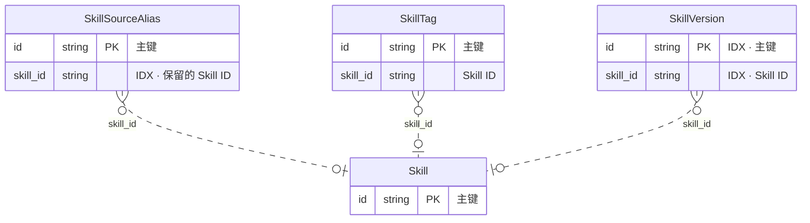

<!-- Code generated by fino. DO NOT EDIT. -->

# 模型 ER 图

模型和字段来自 proto；`.fino/er.yaml` 补充绘图配置与显式关系。图中按“字段名、类型、键、说明”展示，字段语义以详情表和 proto 为准。支持 `fino build --targets=api` 或 `protoc --er_out=docs`。

- 连线仅描述逻辑引用及数量上限：标量至多引用一个对象，集合可引用多个对象。图中不区分业务必需或可选，也不据此声明 SQL 可空性。符合命名和类型规则的推断也绘制逻辑连线，候选来源见关系表。
- 虚线表示非标识关系，实线表示来源字段构成默认主键的标识关系；声明与推断的来源见关系表。`JSON` 标签表示值对象或数组中的逻辑引用。
- 本文不创建数据库外键或业务校验。类型、索引与 NULL 为 proto 标注；`PK` 按默认 `id` 约定展示，实际表名、SQL 类型及约束以服务配置和数据库为准。

## 关系概览

| 来源字段 | 目标字段 | 形式 | 来源 |
|---|---|---|---|
| `skillhub.SkillSourceAlias.skill_id` | `skillhub.Skill.id` | 字段引用 | 显式声明 |
| `skillhub.SkillTag.skill_id` | `skillhub.Skill.id` | 字段引用 | 命名推断（候选） |
| `skillhub.SkillVersion.skill_id` | `skillhub.Skill.id` | 字段引用 | 命名推断（候选） |

## 关联诊断

- skillhub.Skill.default_version_id：目标模型缺失或存在歧义，未建立关联

## 模型详情

### `skillhub.Skill`

来源：[skillhub/skill.proto](../proto/skillhub/skill.proto)

| 字段 | 模型类型 | DB 标注 | 说明 |
|---|---|---|---|
| `id` | `string` | PK（默认约定）；长度 36 | 主键 |
| `name` | `string` | 长度 64；索引 （自动命名） | Skill 名称 |
| `description` | `string` | 长度 1024 | 用途说明 |
| `category` | `string` | 长度 128；索引 （自动命名） | 分类 |
| `notes` | `string` | 长度 4096 | 个人备注 |
| `repository_url` | `string` | 长度 2048 | GitHub 来源地址 |
| `repository_path` | `string` | 长度 1024 | 仓库内 Skill 路径 |
| `local_path` | `string` | 长度 2048；默认值 `''` | 本机原始 Skill 目录；GitHub 来源留空 |
| `source_key` | `string` | 长度 64；唯一索引 `skillhub_source,where:source_key <> ''`；默认值 `''` | 收录来源标识 |
| `import_kind` | `string` | 长度 16；默认值 `''` | folder、github 或 zip |
| `purpose` | `string` | 长度 240；默认值 `''` | 用户整理的一行用途 |
| `upstream_name` | `string` | 长度 120；默认值 `''` | 展示的上游名称 |
| `upstream_url` | `string` | 长度 2048；默认值 `''` | 展示的上游链接 |
| `default_version_id` | `string` | 长度 36；默认值 `''` | 默认导出版本 |
| `create_time` | `timestamp` |  | 创建时间 |
| `update_time` | `timestamp` |  | 最后更新时间 |

### `skillhub.SkillSourceAlias`

来源：[skillhub/skill.proto](../proto/skillhub/skill.proto)

| 字段 | 模型类型 | DB 标注 | 说明 |
|---|---|---|---|
| `id` | `string` | PK（默认约定）；长度 36 | 主键 |
| `skill_id` | `string` | 长度 36；索引 （自动命名） | 保留的 Skill ID |
| `source_key` | `string` | 长度 64；唯一索引 `skillhub_source_alias` | 原收录来源键 |

### `skillhub.SkillTag`

来源：[skillhub/skill.proto](../proto/skillhub/skill.proto)

| 字段 | 模型类型 | DB 标注 | 说明 |
|---|---|---|---|
| `id` | `string` | PK（默认约定）；长度 36 | 主键 |
| `skill_id` | `string` | 长度 36；唯一索引 `idx_skill_tag` | Skill ID |
| `tag` | `string` | 长度 128；唯一索引 `idx_skill_tag` | 标签 |
| `create_time` | `timestamp` |  | 创建时间 |
| `update_time` | `timestamp` |  | 最后更新时间 |

### `skillhub.SkillVersion`

来源：[skillhub/skill.proto](../proto/skillhub/skill.proto)

| 字段 | 模型类型 | DB 标注 | 说明 |
|---|---|---|---|
| `id` | `string` | PK（默认约定）；长度 36；索引 `skillhub_version_owner,priority:2` | 主键 |
| `skill_id` | `string` | 长度 36；索引 `skillhub_version_owner,priority:1` | Skill ID |
| `name` | `string` | 长度 64 | 该版本的 Skill 名称 |
| `notes` | `string` | 长度 4096 | 版本说明 |
| `source_ref` | `string` | 长度 200 | 用户选择的 Git 引用 |
| `commit_sha` | `string` | 长度 40 | 完整 commit SHA |
| `content_digest` | `string` | 长度 64；默认值 `''` | 本地版本的内容摘要 |
| `description` | `string` | 长度 1024；默认值 `''` | 该版本的原始用途 |
| `upstream_commit` | `string` | 长度 40；默认值 `''` | 归档声明的上游 commit |
| `upstream_repository` | `string` | 长度 2048；默认值 `''` | 归档声明的上游仓库 |
| `upstream_path` | `string` | 长度 1024；默认值 `''` | 归档声明的仓库内路径 |
| `create_time` | `timestamp` |  | 创建时间 |
| `update_time` | `timestamp` |  | 最后更新时间 |

